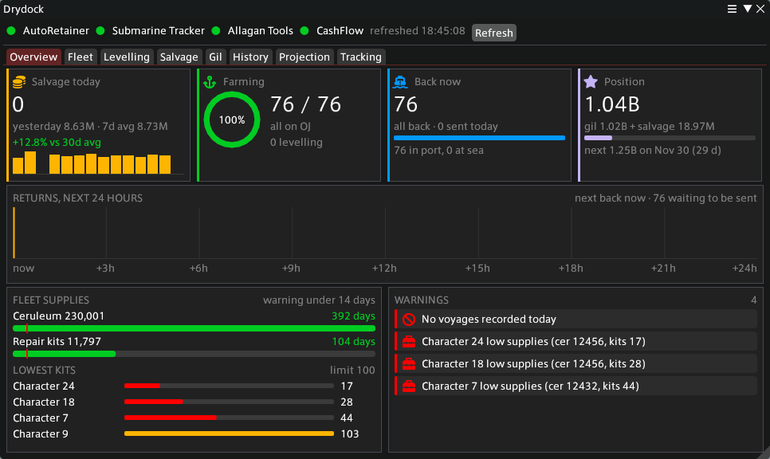
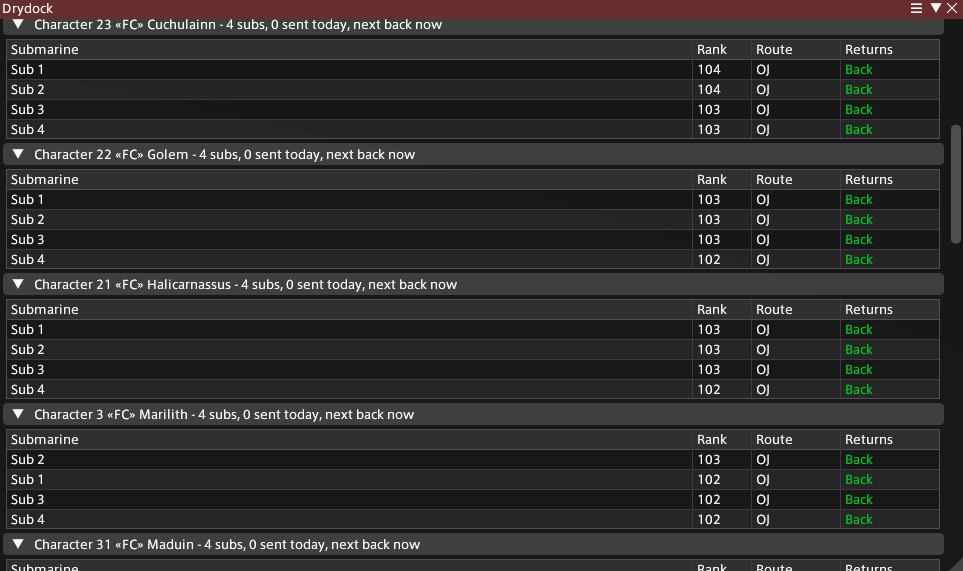
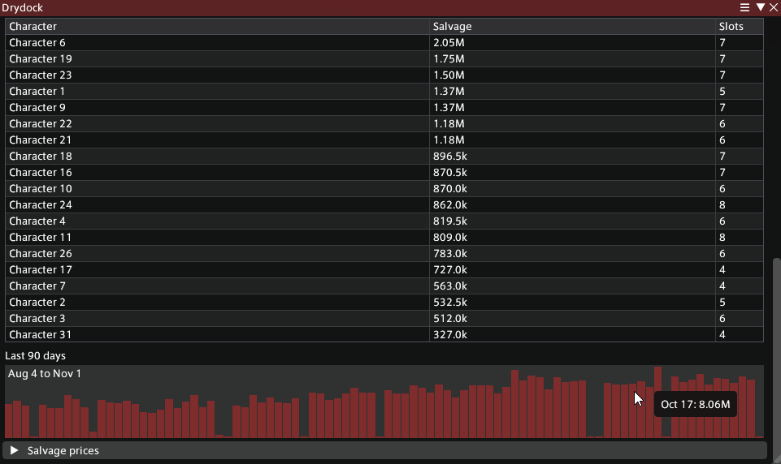
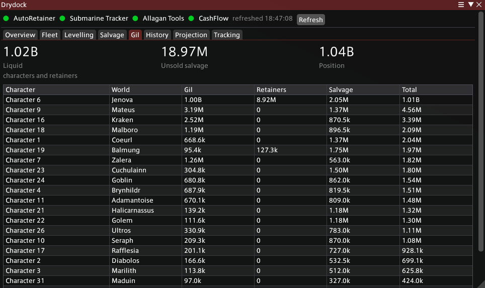
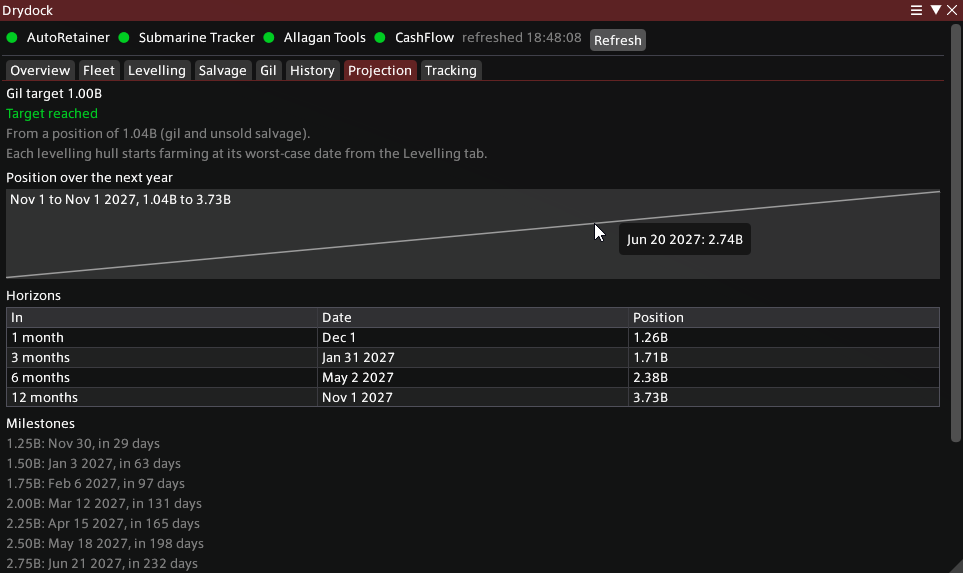

# Drydock

In-game dashboard for FFXIV submarines. I run a lot of subs across a lot of
characters and got tired of piecing it together from three different plugins,
so this pulls it into one window.

What's in it:

- **Overview**: cards for salvage today (with the last two weeks), how many
  hulls are farming, how many are back, and where you stand against the next
  250M. A timeline of everything coming back in the next 24 hours, how many
  days of ceruleum and kits the fleet has left, the characters lowest on
  kits, and warnings for anyone gone quiet or running low. Uses your Dalamud
  theme colours.
- **Fleet**: every sub grouped by FC, with rank, route and a live countdown
  to when it's back.
- **Levelling**: every hull that isn't on a gil route yet, with its route,
  voyage time, EXP per voyage, and a best to worst range for the days left
  to your target rank (85 unless you change it) and the dates. It works off
  the game's own EXP table and each hull's real parts and route, and uses
  how often you actually resend it. Plus a rough rank spread of the fleet.
- **Salvage**: salvage today and yesterday, the 30 and 7 day average with
  the trend, per hull per day, a 90 day chart, what fuel and kits cost you
  per day, net, and how many days of ceruleum and kits you have left. Per
  gil route it shows your real gil per voyage and cycle time next to what
  the route is expected to make. With Allagan Tools installed it also shows the salvage you're
  sitting on: per item, what it's worth and how many slots it takes, and per
  character. Prices are the vendor sell prices of the eight salvage items.
- **Gil**: gil on hand across characters and retainers (straight from
  AutoRetainer), unsold salvage, and the total, with a table per character.
- **History**: Drydock keeps one row a day of its own (gil, salvage held,
  supplies, farming hulls, salvage that day) and charts it, with what you
  actually made per day next to what the model says. Once it has seen 400
  sectors it measures your real ceruleum and kit use per sector and uses
  that for upkeep instead of the settings.
- **Projection**: where your gil is headed over the next year, with hulls
  that are still levelling joining the farm on their worst-case date. When
  you hit your gil target (1B unless you change it), where you land at one,
  three, six and twelve months, every 250M milestone, and what you make now
  against what you'll make once every hull is farming.
- **Tracking**: what Drydock is reading per character (subs, voyages today,
  days since the last one, ceruleum, kits). Untick a character to leave it
  out of everything. Every AutoRetainer character is listed, subs or not.
  Subs AutoRetainer still remembers but that don't exist anymore are listed
  there too, so you know why they're ignored.
- A server info bar entry: "Subs 3 back, next in 1h 12m". Click it to open
  Drydock, or turn it off in settings.

A hull counts as farming when it's on one of the gil routes (OJ, MOJ, ROJ,
JOZ, MROJ, MOJZ, JORZ, MROJZ, RZVOJ, MRVOJ), whatever its rank.

Heads up: on a fresh install the fuel and kit numbers are the defaults in
settings until Drydock has a few days of its own history to measure them.
Still keeping an eye on how close those land.

## Screenshots

Names swapped out, numbers are my real fleet.

| | |
|---|---|
|  |  |
|  |  |

## Install

Settings > Experimental > Custom Plugin Repositories, add

    https://raw.githubusercontent.com/tangent-thorn/Drydock/main/repo.json

then install Drydock from /xlplugins.

## What it needs

- AutoRetainer, from the Puni.sh repo (https://love.puni.sh/ment.json). Required.
- Submarine Tracker. Required.
- Allagan Tools and CashFlow are optional. Allagan Tools adds the salvage
  you haven't sold yet; CashFlow gives the upkeep your real repair kit price
  (median of what you paid over the last 120 days) instead of the setting.

If something's missing, `/drydock setup` tells you what and links the installer.

## Commands

`/drydock` opens it. `/drydock setup`, `/drydock refresh`, `/drydock config`.

Settings has the warning limits (days quiet, low ceruleum, low kits), when
data counts as stale, the info bar toggle, how often you resend subs
(for the levelling dates), and fuel and kit prices and usage per sector for
the upkeep numbers.

AGPL-3.0.
